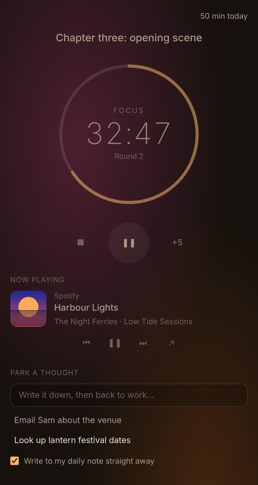

# Lantern Focus

Focus sessions for wandering minds. One note, one block of time, and a calm screen, with your music close at hand. Made with ADHD in mind, and useful for anyone whose attention likes to drift.

## How it works

1. Open the **note** you're going to work on. Lantern shows it as "Focusing on" and links it in your log.
2. Pick a length: **25, 50 or 90 minutes**, each followed by a short break (5, 10 or 15 minutes).
3. Press play. A soft chime starts the session, your music starts, and the screen goes quiet.
4. When a stray thought turns up, **park it** and get straight back to work.
5. At the end, a chime marks the break, your music pauses (unless you've chosen to keep it playing), and the session goes into your daily note. Parked thoughts sit as tasks in one list at the top of the note.

## Features

- **Focus sessions:** a ring timer that glows warm while you focus and cool on a break. Pause, add five minutes, or stop early (the minutes you did still count). After every few rounds you get a longer break. The next round waits until you press play, so a break never runs straight into work.
- **Now playing:** shows what's playing in my other players, [Static FM](https://github.com/AshOtis/static-fm), [Hi-Fi Tuner](https://github.com/AshOtis/hifi-tuner), [Aurora MP3](https://github.com/AshOtis/aurora-mp3) and [MFP Player](https://github.com/AshOtis/mf-player), and, through Aurora MP3's **What's playing on your computer** (Windows), apps such as Spotify. You get the cover, the track, and play/pause, previous and next. Lantern plays no sound of its own except its chimes. With **Music follows the session**, your music starts with a focus session and pauses for the break, or turn off **Pause music for breaks** to keep it playing.
- **Park a thought:** type it in the panel, or run **Lantern Focus: Park a thought** from anywhere (give it a hotkey in **Settings → Hotkeys**). Parked thoughts are saved as tasks in one list under **Parked thoughts** at the top of your daily note (change the heading in settings), out of your head and out of the way.
- **Calm screen:** while you focus, the ribbon, tabs, headers, status bar and file list fade back, and themes with glowing or picture backgrounds quieten down. Only your note stands out. Hover over anything to bring it back. Everything returns on your break.
- **Daily note log:** each session adds a line such as `09:00–09:50 Focused 50 min on Chapter three`. You can turn this off.
- **Today's total:** the minutes you've focused today, at the top of the panel.
- **Status bar:** the time left. Click it to open the panel.
- **Survives a restart:** close Obsidian mid-session and the session is still there when you come back.

## Why these pieces

- **Steady background sound:** a 2024 review of the research found steady background noise gave a small but real boost to task performance for young people with ADHD (and not for others). Static FM makes that noise, and Now playing keeps it one click away.
- **Short, timed blocks with real breaks:** these make starting and stopping easier, which is often the hard part.
- **Writing a thought down:** this lets you let go of it without losing it.
- **A quieter screen:** this means fewer things competing for your attention.

None of this is treatment. It's a set of small helpers that you can switch off.

## Commands

**Open**, **Start, pause or resume**, **Stop the session**, **Five more minutes**, **Park a thought** and **Calm screen on or off**.

## Privacy

Lantern Focus makes no network requests, runs no programs and collects nothing. It writes only to today's daily note (when logging is on) and to its own `data.json`.

## Building from source

There are no dependencies. Run `python3 build.py` to write `main.js`, `styles.css` and `manifest.json` to `dist/`.

## Support

If it helps, you can [buy me a coffee](https://buymeacoffee.com/ashotis). Questions or problems: open an issue, or email Hello@utilitiz.net.

## License

[GNU AGPL v3 or later](LICENSE) © AshOtis
